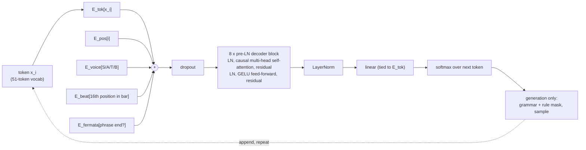
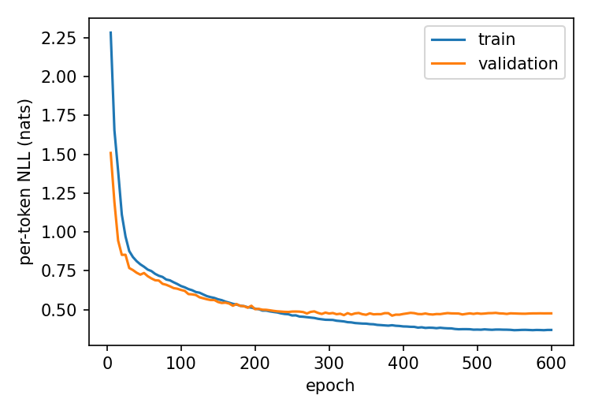

# Rule-Constrained Transformer Generation of Bach-Style Four-Part Chorales

CSC413 project. A decoder-only Transformer generates four-part (soprano, alto, tenor, bass)
chorales in the style of J.S. Bach, one token at a time, from a single sequence that
interleaves the four voices on a 16th-note grid. At generation time a rule mask can forbid
tokens that break counterpoint rules (constrained decoding).

## Model (`src/chorales/model.py`)



Forward pass for position i: the five embeddings are summed into a d = 384 vector, then passed
through 8 blocks. Each block computes `h = h + MHA(LN(h))` with a causal mask (position i only
attends to positions ≤ i), then `h = h + FFN(LN(h))` with `FFN(z) = W2 GELU(W1 z)`. A final
LayerNorm and a linear layer, whose weight is shared with the token embedding, give 51 logits
for the next token. Training uses teacher forcing and cross-entropy (`scripts/train.py`).

### Parameters (final model `big`: d_model 384, 8 layers, 6 heads, d_ff 1536)

| Component | Shape | Parameters |
|---|---|---|
| Token embedding (also the output layer, weights tied) | 51 × 384 | 19,584 |
| Position embedding | 1024 × 384 | 393,216 |
| Voice embedding (S, A, T, B, special) | 5 × 384 | 1,920 |
| Beat-position embedding (0..23, special) | 25 × 384 | 9,600 |
| Fermata embedding | 2 × 384 | 768 |
| Per block: attention Q/K/V (384×1152 + 1152) | | 443,520 |
| Per block: attention output (384×384 + 384) | | 147,840 |
| Per block: FFN (384×1536 + 1536, 1536×384 + 384) | | 1,181,568 |
| Per block: 2 LayerNorms | | 1,536 |
| 8 blocks | 8 × 1,774,464 | 14,195,712 |
| Final LayerNorm | | 768 |
| **Total** | | **14,621,568** |

97% of the parameters are in the Transformer blocks. `param_breakdown(model)` prints this split.

## Training (`scripts/train.py`)

```bash
python scripts/train.py --name big --epochs 600 --d-model 384 --layers 8 --heads 6 --d-ff 1536 --dropout 0.2
python scripts/sample.py runs/big/best.pt --n 5 --template bwv254   # MIDI to runs/big/samples/
```

Settings: AdamW (lr 3e-4, weight decay 0.01), 300-step linear warmup then cosine decay to 0,
batch size 8, max 1,024 input tokens, gradient clipping at 1.0, mixed precision, 600 epochs
of 262 chorales, each with one random allowed transposition per epoch (`augment_mode=sample`).
The checkpoint with the lowest validation NLL is kept. Training takes about 10 minutes on a
lab GPU.

**Sanity check.** With dropout off, the 5M model memorises one chorale (`--overfit bwv269`)
to NLL 0.0000 in about 100 epochs, and sampling from it reproduces bwv269 token for token.



The training NLL is measured with dropout on, on transposed chorales, so it sits above the
validation NLL for most of the run.

### Hyperparameter tuning

The configurations were compared by validation NLL (per token, nats), changing one or two
settings at a time:

| Run | Change from previous | Params | Best val NLL |
|---|---|---|---|
| base | 6 layers, d 256, 4 heads, dropout 0.1, 150 epochs | 5.0M | 0.685 |
| long | 600 epochs | 5.0M | 0.508 |
| long_lr | lr 6e-4 | 5.0M | 0.492 (overfits after epoch ~340) |
| all_aug | every transposition each epoch (`all`), 100 epochs | 5.0M | 0.518 |
| small | d 128, 4 layers | 0.94M | 0.543 |
| mid_d02 | long_lr + dropout 0.2 | 5.0M | 0.474 |
| **big** | d 384, 8 layers, 6 heads, dropout 0.2, lr 3e-4 | 14.6M | **0.461** |
| big_d03 | dropout 0.3, 400 epochs | 14.6M | 0.520 (underfits) |

The base run was stopped too early, since the learning rate reached 0 while the loss was still
falling. With longer training, the higher learning rate began to overfit, and dropout 0.2 fixed
that. Tripling the model size then gave a further 0.013, close to the noise level of the
33-chorale validation set (about ±0.01 between evaluations).

### Test result

| Model | Val NLL | Test NLL |
|---|---|---|
| Transformer (`big`) | 0.461 | 0.525 |

The test set was evaluated once, after the configuration was chosen. The gap from validation
is expected, since the configuration and epoch were both selected on the small validation set.

## Data pipeline

### Build

```bash
python -m venv .venv && .venv/bin/pip install -r requirements.txt && .venv/bin/pip install -e .
.venv/bin/python scripts/build_dataset.py   # writes data/processed/
.venv/bin/python scripts/stats.py           # writes data/processed/stats.json + chorale_distributions.png
.venv/bin/python -m pytest                  # ~15 s
```

`data/processed/` contents:

| File | Committed | What |
|---|---|---|
| `vocab.json` | yes | token string → ID |
| `splits.json` | yes | `{"train": [...], "val": [...], "test": [...], "seed": 413}` (chorale IDs like `bwv269`) |
| `ranges.json` | yes | per-voice MIDI min/max **over the train split**. The rule checker's range rule must read this file |
| `dropped.csv` | yes | every file removed during cleaning, with the reason |
| `stats.json`, `chorale_distributions.png` | yes | report Table 1 / Figure 1 numbers |
| `encoded.json` | no (regenerate) | encoded token + feature lists for all 327 chorales |

### Cleaning (`load.py`)

Source: the Bach chorales bundled with music21 (`corpus.chorales.Iterator`).
371 iterator entries → 350 unique filenames → drop 19 with ≠ 4 parts and 2 with 32nd notes
(off the 16th grid) → **329** → drop 2 exact content duplicates (`bwv274` = `bwv62.6`,
`bwv69.6` = `bwv69.6-a`) → **327 chorales**. Voice v is part index v (0 = S, 1 = A, 2 = T,
3 = B), checked by strictly decreasing mean pitch. `partName` is never used.

### Token format (`encode.py`)

Each chorale sits on a 16th-note grid. One step = one 16th note = 4 tokens (S, A, T, B):

```
<START>  S0 A0 T0 B0  S1 A1 T1 B1  ...  S(T-1) A(T-1) T(T-1) B(T-1)  <END>      length = 4T + 2
```

Slot rule for voice v at step t:
- a rest is sounding → `REST` (on every step of the rest, never `HOLD`)
- a note starts at t and is **not** a tie continuation → its pitch ID
- otherwise (the note started earlier, or is tied into t) → `HOLD`

A re-sung note (same pitch again) is a new pitch token. Grace notes (zero length, 3 in the
corpus) are skipped.

BWV 269 starts `[1, 36, 31, 28, 12, 3, 3, 3, 3, ...]` = `<START>`, G4 D4 B3 G2, then holds.

### Vocabulary (`vocab.py`, 51 tokens)

| Token | ID |
|---|---|
| `<PAD>` | 0 |
| `<START>` | 1 |
| `<END>` | 2 |
| `HOLD` | 3 |
| `REST` | 4 |
| MIDI pitch 36..81 | pitch − 31 (5..50) |

Helpers: `pitch_to_id`, `id_to_pitch`, `is_pitch`, `token_name`.

### Features (same length as `ids`)

| Feature | Values | Meaning |
|---|---|---|
| `voice` | 0..3, 4 for specials | which voice the slot belongs to |
| `beat_pos` | 0..23, 24 for specials | 16th-note position within the bar, from the measure structure: `(measure.paddingLeft + offset in measure) * 4`. A pickup bar starts mid-bar (BWV 269 starts at 8). 4/4 → 0..15, 3/4 → 0..11, 3/2 → 0..23 |
| `fermata` | 0/1 | the soprano note sounding at this step has a fermata (phrase end). Same value for all 4 slots of a step |
| `onset` | 0/1 | token is a pitch or `REST` (for evaluation) |

### Decoding and MIDI

```python
from chorales.encode import decode, write_midi
score = decode(ids, time_signature="4/4")   # music21 Score, 4 parts; <START>/<END>/<PAD> stripped
write_midi(ids, "out/sample.mid", "3/4")
```

`encode(decode(encode(s)))["ids"] == encode(s)["ids"]` holds for all 327 chorales.

### Format grammar for generation (`grammar.py`)

`allowed_tokens(ids_so_far) -> set[int]`. Apply this first, then the music rules from the rule
checker on top.
- never `<START>` or `<PAD>`; nothing after `<END>`
- `HOLD` only if the current voice has a note sounding (not at its first slot, not after `REST`)
- `<END>` only when the step is complete (next slot would be soprano) and at least one step exists

Any sequence built only from allowed tokens decodes without error (property-tested).

### Split (`split.py`)

Chorales with the same soprano interval sequence (transposition-invariant, ties merged) form
one melody group (11 groups of 2+). Groups are shuffled with seed 413 and assigned so the
sizes track 80/10/10: **train 262 / val 33 / test 32**. No chorale and no melody appears in
two splits.

### Augmentation (`augment.py`)

`allowed_shifts(ids, ranges)` returns the semitone shifts k in −6..+5 that keep every voice
inside the train-split range. `transpose(ids, k)` adds k to pitch IDs only. The mean number
of allowed shifts on the train split is **6.90** (7.28 using full-data ranges), so the
effective augmentation factor is about 7×, not 12×. Val/test are never transposed.

Two modes (`augment_mode`):
- `sample` (default): each time a chorale is drawn, it gets one random allowed shift. 262
  items per epoch, and every chorale is seen equally often.
- `all`: every allowed shift is its own item. 1,807 items per epoch, but chorales are
  unbalanced (3 to 12 copies).

### Dataset API (`dataset.py`)

```python
from torch.utils.data import DataLoader
from chorales.dataset import ChoraleDataset, collate_fn, generation_features

train = ChoraleDataset("train", max_len=1024, augment_mode="sample", seed=0)
val = ChoraleDataset("val", max_len=1024)          # train=False by default for val/test
loader = DataLoader(train, batch_size=16, shuffle=True, collate_fn=collate_fn)
batch = next(iter(loader))
# batch["input_ids"], batch["target_ids"], batch["voice"], batch["beat_pos"],
# batch["fermata"], batch["onset"], batch["pad_mask"]: all LongTensor/BoolTensor of shape (B, L)
```

- `input_ids = ids[:-1]`, `target_ids = ids[1:]`; features are aligned with the inputs.
- Padding: inputs use `<PAD>` = 0, targets use −100 (use `ignore_index=-100` in
  `CrossEntropyLoss`), `voice` 4, `beat_pos` 24, `fermata`/`onset` 0. **`pad_mask` is True at
  padded positions** (PyTorch `key_padding_mask` convention).
- Long chorales (71 of 327 are over 1,025 tokens; max 3,090):
  - **train**: a random window of `max_len + 1` tokens per draw, starting at position 0 or
    at a step boundary (1 + 4k).
  - **val/test**: consecutive windows, so every target is predicted exactly once. Windows
    after the first start at a step boundary without earlier context. (D3, sliding vs.
    consecutive windows, is still open.)
- `generation_features(position, time_signature, fermata_template=None, start_beat_pos=0)`
  returns `voice`, `beat_pos` and `fermata` for a new position (0 = `<START>`) in the sampling
  loop. Pass `start_beat_pos` for a pickup (e.g. 8 for BWV 269 in 3/4), and an optional
  per-step 0/1 fermata template.

### Known data issues

- **Duplicates**: the iterator yields 371 entries but only 350 files. On top of that,
  `bwv62.6`/`bwv274` and `bwv69.6`/`bwv69.6-a` are identical (the `bwv69.6` name resolves to
  the `-a` file). The proposal's "347 chorales" counted the repeated entries; the real
  number is 327.
- **Ambiguous names**: `corpus.parse(name)` matches files by prefix. `bwv112.5` and
  `bwv190.7` load orchestral versions and are dropped as not 4-part, even though plain 4-part
  `.mxl` files exist. We kept `corpus.parse` so the numbers match the plan.
- **Unnamed parts**: `bwv277`, `bwv281` and `bwv366` load from Humdrum `.krn` files with
  `partName = None`. They pass, because voices are identified by part index.
- **Ties**: 770 tied-note continuations become `HOLD`. The old proposal stats script treated
  them as re-struck notes.
- **Irregular bars**: `bwv324` has a 10-beat measure in 4/4, so its `beat_pos` wraps modulo
  the bar length. `generation_features` assumes a regular meter, which differs from the
  encoded `beat_pos` in 9 chorales (time-signature changes in `bwv362`/`bwv304`, odd-length
  bars).
- **Range edge**: the only note outside the train ranges is one soprano A3 (MIDI 57) in test
  chorale `bwv254`. A range rule using `ranges.json` will flag it.
- **Repeats are not expanded**: chorales are modelled as written.
